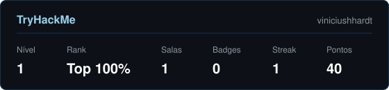

 

---

### Resumo

| | |
|---|---|
| **Atual** | Java Developer — Neomind (desde out/2025) · Fusion Platform (BPM) |
| **Anterior** | Grupo Orbenk (fev/2024 – set/2025) |
| **Atuação** | Sustentação de sistemas em produção · integrações REST/SOAP · chamados de suporte (Jira) |
| **Formação** | Engenharia de Software — UNIVILLE (2024 – 2028) |
| **Foco** | DevOps · Infraestrutura em nuvem · Cyber Security |

---

### Linguagens no GitHub

Atualizado diariamente por GitHub Actions · calculado por bytes de código em todos os repositórios

---

### Stack

| Área | Ferramentas | Nível |
|---|---|---|
| **Java** |    | Uso profissional desde fev/2024 · certificação FIAP |
| **Integrações** |     | Uso profissional |
| **Segurança** |     | Formação FIAP em andamento · TryHackMe |
| **DevOps** |     | Certificação FIAP |
| **Infraestrutura** |   | Certificação FIAP · projetos pessoais |
| **Dados** |   | Uso profissional |
| **Outras linguagens** |   | — |
| **Ferramentas** |     | Uso diário |

---

### TryHackMe

---

### Aprendendo agora

| Área | Tópicos |
|---|---|
| **Cloud / DevOps** |    automação de pipelines |
| **AppSec** | OWASP Top 10 em APIs Java · JWT / OAuth2 · análise de dependências (SCA) |
| **Containers** | Hardening de imagens e containers Docker |
| **Redes** | Fundamentos de redes e segurança de infraestrutura |

---

### Certificações

| | Certificado | Instituição | Carga | Data | Validação |
|:---:|---|---|:---:|:---:|---|
| 🟡 | **Cyber Security** | FIAP | — | em andamento | — |
| ✅ | DevOps & Agile Culture | FIAP | 60h | 03/10/2026 | [`E6C6EB08…F1DBF2D899`](https://on.fiap.com.br/validar-certificado/) |
| ✅ | Gestão de Infraestrutura de TI | FIAP | 20h | 30/09/2026 | [`924F3849…5D5C9394`](https://on.fiap.com.br/validar-certificado/) |
| ✅ | Java Development | FIAP | 60h | 01/09/2026 | [`0437ACAE…9B5235`](https://on.fiap.com.br/validar-certificado/) |
| ✅ | Claude 101 | Anthropic Academy | — | — | [verificar](https://academy.claude.com/verify/545b32c8b24dccac98f94d1c3d30c67d) |
| ⬜ | Certificação Cisco (Networking Academy) | Cisco | — | objetivo | — |
| ⬜ | CompTIA Security+ | CompTIA | — | objetivo | — |

Chaves completas de validação FIAP

| Certificado | Chave |
|---|---|
| DevOps & Agile Culture | `E6C6EB084788CC473CCD32F1DBF2D899` |
| Gestão de Infraestrutura de TI | `924F38494FE3F4A801B4B40D5D5C9394` |
| Java Development | `0437ACAE69B90920DABEC89E5C9B5235` |

Validar em [on.fiap.com.br/validar-certificado](https://on.fiap.com.br/validar-certificado/)

---

### Atividade

  

<picture>
  <source media="(prefers-color-scheme: dark)" srcset="https://raw.githubusercontent.com/lvwerner/lvwerner/output/snake-dark.svg"/>
  
</picture>

